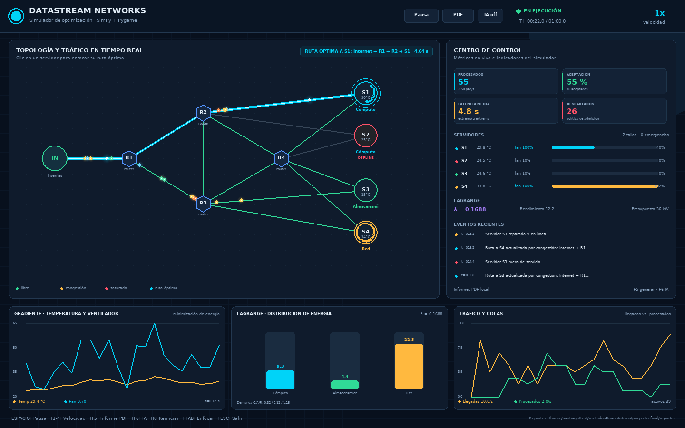

# DataStream Networks

Simulador académico de optimización para una red de centros de datos. Integra
SimPy para la simulación de eventos discretos, Pygame para el dashboard,
programación dinámica para rutas y admisión, optimización no lineal para
refrigeración y Lagrange para el presupuesto eléctrico.

El proyecto corresponde a la asignatura **Métodos Cuantitativos** de la
Universidad José Antonio Páez. La corrida de demostración incluye tráfico,
congestión, fallas de nodos, control térmico, cambios de ruta y generación de
un informe PDF con análisis técnico.



## Características principales

- Llegadas Poisson y servicio exponencial con métricas de colas `L`, `Lq`, `W`
  y `Wq` para un modelo M/M/c.
- Enrutamiento dinámico con Bellman-Ford y latencia efectiva dependiente de la
  congestión.
- Histéresis del 15 % y tiempo de enfriamiento de 6 s para evitar cambios de
  ruta innecesarios.
- Admisión por mochila binaria 2D con restricciones independientes de CPU y RAM.
- Fallas y reparaciones estocásticas de routers y servidores.
- Modelo térmico cúbico con puntos críticos calculados analíticamente.
- Control de ventiladores por gradiente proyectado.
- Asignación del presupuesto eléctrico por multiplicadores de Lagrange.
- Dashboard con topología animada, paquetes en movimiento, alertas, KPIs,
  gráficos en tiempo real y enfoque de rutas.
- Integración opcional con una API de IA compatible con OpenAI.
- Informe PDF autocontenido de seis páginas, sin ReportLab ni FPDF.
- Validación estricta de la configuración y las opciones de línea de comandos.
- 53 pruebas unitarias y de integración con `unittest`.

## Requisitos

- Python 3.10 o superior.
- `simpy` y `pygame`.
- Para el informe no se requieren librerías externas; el PDF se construye con
  un motor propio.

## Instalación

```bash
python3 -m venv .venv
source .venv/bin/activate
pip install -r requirements.txt
```

En Windows, la activación del entorno es:

```powershell
.venv\Scripts\activate
```

## Ejecución

### Dashboard interactivo

```bash
python main.py
```

### Modo consola con informe PDF

```bash
python main.py --sin-ui --duracion 60 --semilla 7 --reporte reportes/informe.pdf
```

### Configuración desde JSON

```bash
python main.py --sin-ui --config datos_ejemplo.json --reporte reportes/informe.pdf
```

### Con análisis por IA

```bash
export DATASTREAM_IA_API_KEY="su-clave"
python main.py --sin-ui --usar-ia --reporte reportes/informe_ia.pdf
```

También se puede usar un endpoint local compatible con OpenAI:

```bash
export DATASTREAM_IA_URL="http://127.0.0.1:11434/v1/chat/completions"
export DATASTREAM_IA_MODELO="llama3.2"
python main.py --sin-ui --usar-ia
```

Si la API falla, falta la clave o el endpoint no responde, el informe continúa
con el análisis determinista local. La clave nunca se guarda en archivos ni se
incluye en el PDF.

### Ayuda

```bash
python main.py --help
```

## Controles del dashboard

| Tecla | Acción |
| --- | --- |
| `ESPACIO` / `P` | Pausar o reanudar |
| `1`, `2`, `3`, `4` | Velocidad 0.5x, 1x, 2x y 4x |
| `F5` | Generar informe PDF |
| `F6` | Activar o desactivar el análisis por IA |
| `R` | Reiniciar la simulación |
| `TAB` | Cambiar el servidor enfocado |
| Clic en servidor | Enfocar su ruta |
| `ESC` / `Q` | Salir |

El botón `PDF` de la cabecera inicia la generación en un hilo aparte para no
bloquear la animación.

## Modelos matemáticos

### 1. Enrutamiento con programación dinámica

La latencia efectiva del enlace es:

```text
w(u, v) = w0 * (1 + beta * utilizacion^1.35)
```

Bellman-Ford calcula la ruta de mínima latencia mediante la recurrencia:

```text
d_k(v) = min(d_(k-1)(v), min_u[d_(k-1)(u) + w(u, v)])
```

Las rutas se recalculan periódicamente y cuando ocurre una falla o reparación.

### 2. Mochila binaria 2D

Cada servidor resuelve:

```text
V(i, c, r) = max(V(i-1, c, r), V(i-1, c-cpu_i, r-ram_i) + valor_i)
```

El valor combina la prioridad del paquete y su tamaño. La solución se reconstruye
hacia atrás y respeta simultáneamente la CPU y la RAM libres.

### 3. Modelo térmico de una variable

```text
T(c) = a*c^3 + b*c^2 + d*c + e
```

Con los coeficientes de demostración:

- Máximo local: `c = 0.60`, `T = 60.64 °C` (punto de emergencia).
- Punto de inflexión: `c = 0.85`.
- Mínimo local: `c = 1.10` (zona de throttling).

### 4. Refrigeración por gradiente

La potencia del ventilador se modela como:

```text
P(f, L) = P0 + cv*f^3 + c1*max(0, T(f,L)-Tobj)^2
          + c2*max(0, T(f,L)-Temer)^2
```

El gradiente `dP/df` se calcula analíticamente y se aplica con descenso
proyectado y retroceso de paso para mantener `f` en `[0.1, 1.0]`.

### 5. Lagrange para el presupuesto eléctrico

Para cada clúster se maximiza:

```text
R_i(e_i) = w_i * sqrt(e_i)
sujeto a  sum(e_i) = E
```

La solución analítica es:

```text
e_i = E * w_i^2 / sum(w_j^2)
lambda = 0.5 * sqrt(sum(w_j^2) / E)
```

El multiplicador `lambda` es el valor marginal del presupuesto eléctrico. La
implementación verifica numéricamente la restricción y la igualdad de los
rendimientos marginales.

### 6. Teoría de colas

Se reporta un modelo M/M/c por servidor, con `c = 4` canales, tasa observada
`lambda`, servicio `mu`, utilización `rho = lambda/(c*mu)` y las métricas `Lq`,
`L`, `Wq` y `W`. Si `rho >= 1`, el sistema se marca como inestable.

## Configuración

Los valores se validan antes de iniciar la simulación. Los campos disponibles
son:

| Campo | Valor por defecto | Rango |
| --- | --- | --- |
| `nombre_equipo` | `Equipo DataStream` | Texto no vacío, máximo 80 caracteres |
| `duracion` | `120.0` | 10 a 7200 s |
| `semilla` | `42` | 0 a 4294967295 |
| `tasa_llegada` | `6.0` | 0.1 a 100 paq/s |
| `capacidad_buffer` | `36` | 4 a 500 |
| `intervalo_planificacion` | `0.65` | 0.1 a 10 s |
| `intervalo_rutas` | `1.25` | 0.1 a 10 s, menor que la duración |
| `factor_congestion` | `2.8` | 0 a 20 |
| `mtbf_router` | `170.0` | 10 a 10000 s |
| `mtbf_servidor` | `135.0` | 10 a 10000 s |
| `tiempo_reparacion` | `12.0` | 0.5 a 1000 s, menor que los MTBF |
| `presupuesto_energia` | `36.0` | 1 a 10000 kW |
| `pesos_cluster` | `[1.25, 1.0, 1.1]` | Tres números positivos |

También se aceptan los alias `duracion_s`, `tasa_paquetes`, `buffer`,
`presupuesto_electrico` y `pesos`. Las claves desconocidas, los tipos inválidos,
los valores no finitos y los rangos incorrectos se rechazan con un mensaje
legible.

## Estructura del proyecto

```text
proyecto-final/
├── main.py                     Punto de entrada y CLI
├── datos_ejemplo.json          Configuración de demostración
├── requirements.txt            Dependencias de ejecución
├── README.md
├── GUIA_DEFENSA.md             Guion y preguntas para la defensa
├── datastream/
│   ├── configuracion.py        Dataclass y validación
│   ├── red.py                  Topología y Bellman-Ford
│   ├── mochila.py              Mochila binaria 2D
│   ├── termodinamica.py        Modelo térmico y gradiente
│   ├── lagrange.py             Asignación energética
│   ├── simulador.py            Motor SimPy y métricas
│   ├── ia.py                   Cliente HTTP y respaldo local
│   ├── reporte.py              Motor PDF e informe técnico
│   └── visualizacion.py        Dashboard Pygame
├── tests/                      53 pruebas automatizadas
└── reportes/
    ├── dashboard_demo.png      Captura de la interfaz
    ├── prueba2.pdf             Informe de la corrida de prueba
    └── informe_ejemplo.pdf     Informe generado con datos_ejemplo.json
```

## Informe PDF

El informe incluye:

1. Portada con resumen de la corrida.
2. Resumen ejecutivo y métricas principales.
3. Configuración y trazabilidad metodológica.
4. Módulo 1: rutas, latencia y soluciones de mochila.
5. Módulo 2: puntos críticos, gradiente, Lagrange y gráficos.
6. Módulo 3: resultados SimPy, teoría de colas, descartes y cobertura visual.
7. Análisis asistido por IA o análisis local de respaldo.
8. Conclusiones y recomendaciones.

Para generar el ejemplo incluido:

```bash
python main.py --sin-ui --duracion 30 --semilla 7 --reporte reportes/prueba2.pdf
```

## Pruebas

```bash
python -m unittest discover -s tests -v
```

La suite cubre configuración, topología, congestión y fallas, mochila, Lagrange,
termodinámica, integración SimPy, reproducibilidad, cliente de IA y estructura
del PDF.

## Solución de problemas

### No se puede abrir la ventana en un servidor

Use el modo consola:

```bash
python main.py --sin-ui
```

Para probar el dashboard sin pantalla física:

```bash
SDL_VIDEODRIVER=dummy python main.py
```

### pygame no está instalado

```bash
pip install -r requirements.txt
```

La importación de Pygame se hace solo al abrir la interfaz; el modo consola no
depende de ella después de instalar SimPy.

### La IA no responde

Verifique `DATASTREAM_IA_API_KEY`, `DATASTREAM_IA_URL` y `DATASTREAM_IA_MODELO`.
El simulador no se detendrá: usará el análisis determinista local y dejará
constancia del error en el informe.

## Reproducibilidad

La semilla controla las llegadas, los tiempos de servicio y las fallas. Dos
corridas con la misma configuración y semilla producen las mismas métricas
principales. Las rutas y la asignación energética también son deterministas para
una secuencia de eventos dada.
